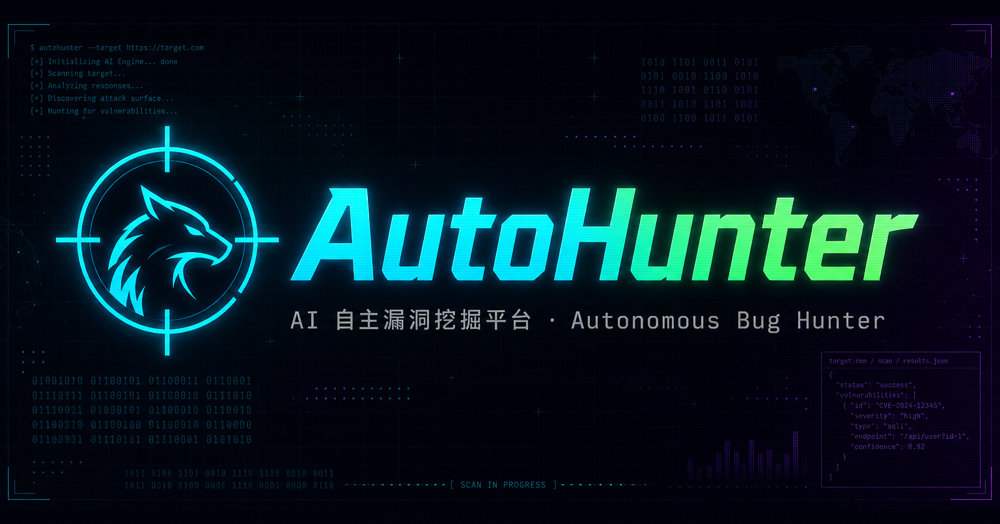
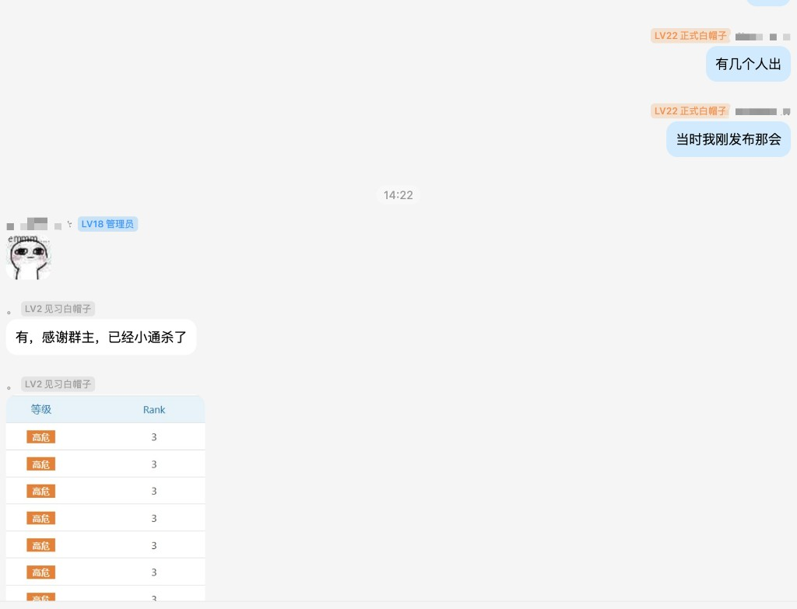
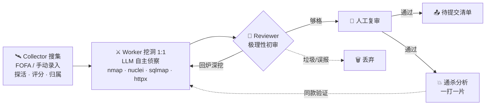

<div align="center">



> **⚠️ 这是二次开发分支（Fork），不是上游原版**
>
> 基于 [StanleyNull/AutoHunter](https://github.com/StanleyNull/AutoHunter) 二次开发，遵循 Apache License 2.0，
> 保留原作者署名与 NOTICE。上游作者：[@StanleyNull](https://github.com/StanleyNull)。
>
> **本分支做了什么、和原版差在哪，全部写在下面的 [二开说明](#二开说明) 里**，
> 建议先看那一节再决定是否使用。本分支引入的问题请提到本仓库 Issue，不要打扰上游作者。

### 多 Agent 协同 · 24×7 自动挖洞 · 人工只做复审决策

`锁定 · 侦察 · 出洞`

**一台机器 = 24×7 不停歇的挖洞平台。你只当「人工复审员」，醒来几分钟完成裁决。**

[](https://github.com/kjc1766/AutoHunter2.1/stargazers)
[](https://github.com/kjc1766/AutoHunter2.1/network/members)
[](https://github.com/kjc1766/AutoHunter2.1/issues)
[](https://github.com/kjc1766/AutoHunter2.1/commits)


<br>

### 这个分支相比原版，多了什么

<table>
<tr><td width="33%" valign="top">

**🧱 挖洞质量**

- 知识库 **187 篇**（HackerOne 真实案例 + 国产系统字典）
- **CVSS 3.1** 官方公式算分，压自评虚高
- 二次验证分类，工具没跑成不判死真洞
- 受阻目标「解锁条件」机制，不重复撞墙

</td><td width="33%" valign="top">

**🛡 安全红线（本分支重点）**

- **禁全量脱库**：样本 + COUNT 代替拖全库
- 提示词 + 代码双层拦截 `--dump` / `SELECT *` 无 LIMIT
- **6 条可选红线**：通用SRC / RCE / SSRF / 容器逃逸 / 上传 / 凭据
- 审核器同步红线边界，不因「没拖全库」打回真洞

</td><td width="33%" valign="top">

**⚙️ 稳定性与成本**

- 同类漏洞产量熔断（默认 2 条封顶，省 token）
- 未证实两次自动归档，不再无限重审
- `database is locked` 退避重试，不再判死目标
- 事件日志 7 天自动归档，库不再无限膨胀

</td></tr>
</table>

> 完整清单与「为什么这么改」→ **[二开说明](#二开说明)**

<br>

### Contributors

<div align="center">

<table>
  <tr>
    <td align="center" width="100">
      <a href="https://github.com/StanleyNull">
        <br />
        <sub><b>StanleyNull</b></sub>
      </a><br /><sup>Author</sup>
    </td>
    <td align="center" width="100">
      <a href="https://github.com/bitter999">
        <br />
        <sub><b>bitter999</b></sub>
      </a><br /><sup>Engines</sup>
    </td>
    <td align="center" width="100">
      <a href="https://github.com/Star-233">
        <br />
        <sub><b>Star-233</b></sub>
      </a><br /><sup>Agent UX</sup>
    </td>
    <td align="center" width="100">
      <a href="https://github.com/2234223561">
        <br />
        <sub><b>2234223561</b></sub>
      </a><br /><sup>Agent UX</sup>
    </td>
    <td align="center" width="100">
      <a href="https://github.com/SD9ard3n">
        <br />
        <sub><b>SD9ard3n</b></sub>
      </a><br /><sup>LLM Pool</sup>
    </td>
    <td align="center" width="100">
      <a href="https://github.com/YiKongk">
        <br />
        <sub><b>YiKongk</b></sub>
      </a><br /><sup>FOFA API</sup>
    </td>
  </tr>
</table>

<table>
  <tr>
    <td align="center" width="100">
      <a href="https://github.com/1diot9">
        <br />
        <sub><b>1diot9</b></sub>
      </a><br /><sup>Workdir Cleanup</sup>
    </td>
    <td align="center" width="100">
      <a href="https://github.com/qianchongceng0-cyber">
        <br />
        <sub><b>qianchongceng0</b></sub>
      </a><br /><sup>Contributor</sup>
    </td>
    <td align="center" width="100">
      <a href="https://github.com/jacketser">
        <br />
        <sub><b>jacketser</b></sub>
      </a><br /><sup>Activity Stream</sup>
    </td>
    <td align="center" width="100">
      <a href="https://github.com/DmcforSpc">
        <br />
        <sub><b>DmcforSpc</b></sub>
      </a><br /><sup>Kimi Code</sup>
    </td>
    <td align="center" width="100">
      <a href="https://github.com/moliyu1101">
        <br />
        <sub><b>moliyu1101</b></sub>
      </a><br /><sup>DNS Probe</sup>
    </td>
    <td align="center" width="100">
      <a href="https://github.com/Saide-sec">
        <br />
        <sub><b>Saide-sec</b></sub>
      </a><br /><sup>Frontend UX</sup>
    </td>
  </tr>
</table>

<table>
  <tr>
    <td align="center" width="100">
      <a href="https://github.com/tf748i5gf5t">
        <br />
        <sub><b>tf748i5gf5t</b></sub>
      </a><br /><sup>Reviewer Fix</sup>
    </td>
    <td align="center" width="100">
      <a href="https://github.com/LLYHXX">
        <br />
        <sub><b>LLYHXX</b></sub>
      </a><br /><sup>List Pinning</sup>
    </td>
    <td align="center" width="100">
      <a href="https://github.com/vtaskstar">
        <br />
        <sub><b>vtaskstar</b></sub>
      </a><br /><sup>LLM Headers</sup>
    </td>
    <td align="center" width="100">
      <a href="https://github.com/Windsweet97">
        <br />
        <sub><b>Windsweet97</b></sub>
      </a><br /><sup>Helper</sup>
    </td>
    <td align="center" width="100">
      <a href="https://github.com/wr0x00">
        <br />
        <sub><b>wr0x00</b></sub>
      </a><br /><sup>Proxy Pool</sup>
    </td>
    <td align="center" width="100">
      <a href="https://github.com/cnzxo">
        <br />
        <sub><b>cnzxo</b></sub>
      </a><br /><sup>WAL Checkpoint</sup>
    </td>
  </tr>
</table>

<table>
  <tr>
    <td align="center" width="100">
      <a href="https://github.com/kerlingcode">
        <br />
        <sub><b>kerlingcode</b></sub>
      </a><br /><sup>LLM Tool Calls</sup>
    </td>
    <td align="center" width="100">
      <a href="https://github.com/1ceS1amese">
        <br />
        <sub><b>1ceS1amese</b></sub>
      </a><br /><sup>Queue Cooling</sup>
    </td>
  </tr>
</table>

</div>

<br>

<sub>
完整名单与加入方式 → <a href="CONTRIBUTORS.md">如何成为 Contributor</a>
（有 commit 合进 <code>main</code> 的也会出现在
<a href="https://github.com/StanleyNull/AutoHunter/graphs/contributors">GitHub Contributors</a>）
</sub>

<br><br>

---

<br>

[快速开始](#快速开始) · [功能亮点](#功能亮点) · [创建任务](#创建任务) · [配置](#必填与推荐配置) · [运维](#运维与长期运行) · [避坑](#注意事项与避坑) · [Contributors](CONTRIBUTORS.md)


Powered By **StanleyNull** · 作者 EduSRC 主页：<https://src.sjtu.edu.cn/profile/46491/>

<br>



<sub>战绩可查</sub>

</div>

> [!WARNING]
> **只测已经书面授权的目标。** 本工具采用 Apache License 2.0，未授权使用的后果由使用者承担。
> 删除操作有限制，但模型仍可能在个别情况下改动或删除少量数据。使用即表示你了解并自行承担后果。问题请提 Issue。

> [!NOTE]
> 🌱 抛砖引玉，欢迎 Star / Issue / 二次开发。

---

## 目录

**先读本分支的改动（与原版的全部差异）**

- **[二开说明](#二开说明)** ← 安全红线 · 挖洞质量 · 稳定性 · 已知短板

**以下为上游原有内容（本分支未做删减，仅适配补充）**

- [这是什么](#这是什么)
- [功能亮点](#功能亮点)
- [快速开始](#快速开始)
- [创建任务](#创建任务)
- [必填与推荐配置](#必填与推荐配置)
- [运维与长期运行](#运维与长期运行)
- [注意事项与避坑](#注意事项与避坑)
- [技术栈](#技术栈)
- [贡献与反馈](#贡献与反馈)
- [如何成为 Contributor](CONTRIBUTORS.md)
- [许可协议](#许可协议)

---

## 二开说明

> 本节是本分支与原版的**全部差异清单**。上游原有能力未做删减，改动集中在「判断质量」与「稳定性」，上游核心（`executor` / `collector` / `dedup` / `llm`）未动。
>
> 对比基线：上游 `StanleyNull/AutoHunter` @ `3b1d943`（2026-10-12）。
> 对比方法：拉取上游真实代码逐文件归一化行尾后 `difflib` 比对，不是凭记忆列举。

### 总览

| 维度 | 上游 | 本分支 | 变化 |
|---|---|---|---|
| 文件数 | 186 | 381 | **+195** |
| 删除上游文件 | — | — | **0**（没有删任何东西） |
| 移除上游功能 | — | — | **0** |
| 修改文件 | — | — | 约 27（含近期 17 次提交） |
| 代码行变化（py） | — | — | **约 +2650 / −119** |

删掉的行全部是改写时被替换的旧逻辑，**没有任何功能被移除**。

---

### 一、安全红线（本分支的重点）

这是本分支最核心的新增能力，上游完全没有。

#### 1.1 禁止全量脱库（自身红线，无开关，永远生效）

**问题**：上游提示词在三处**主动鼓励**脱库 ——

```
「注入→注出库名/脱身份证或密码哈希（盲注逐位提，提出完整哈希即成功）」
「① 先注出库名/表名，再脱敏感表：账号+密码哈希、身份证、手机号」
「必须打到【脱出死规矩数据】。盲注就逐位提取」
```

这条规则在授权测试里会让 worker 真的把整张表拖下来。

**本分支改成「样本 + 计数」**：

```
注入 → 注出库名/表名 + 取 3-5 条敏感字段样本 + 一条 COUNT(*) 证明规模
```

新增「禁止全量脱库（最小充分取证）」完整章节：

| 规则 | 内容 |
|---|---|
| 样本代替全量 | 敏感表只取 `LIMIT 3`（3-5 条），另加 `COUNT(*)` 说明规模 |
| 禁止清空式查询 | `SELECT * FROM 表` 无 LIMIT、`WHERE 1=1`、`--dump`/`--dump-all`、`mysqldump`/`pg_dump`、`INTO OUTFILE` |
| 盲注上限 | 单字段最多取前 8 位，单目标总盲注字符数 ≤200 |
| 禁止落盘 | 脱出数据不写文件、不入知识库 |
| 禁止批量校验 | 不拿脱出的身份证/手机号撞其他系统 |
| 凭据类只交报告 | 拿到 AK/SK、kubeconfig、DB 密码后直接交报告，不自行深入 |

**代码层硬兜底**（不只是提示词）：

- `app/tools/guard.py` 新增 `_DUMP_ALL_PATTERNS`，拦截 sqlmap `--dump-all`、`mysqldump`、`pg_dump`、`SELECT *` 无 LIMIT、`WHERE 1=1`、`INTO OUTFILE`
- `app/tools/executor.py` 新增 `MAX_DUMP_ROWS`（默认 20）

实测：脱库命令 **7/7 拦下**，样本查询 **4/4 正常放行**。

#### 1.2 任务级可选红线（6 条，新建任务时勾选）

不同 SRC 项目对「能不能拿凭据去登录」「能不能探内网」的要求不一样，交给用户按项目决定。

`app/redlines.py` 定义 6 条：

| 红线 | 内容 |
|---|---|
| **通用 SRC** | 翻找敏感凭据、增删改均属禁止；拿 AK/SK、kubeconfig 后直接交报告，不自行深入 |
| **RCE** | 禁反弹 Shell、落地 WebShell、提权、横向移动、读敏感文件；证明命令可执行即止 |
| **SSRF** | 禁探测内网、访问云元数据（169.254.169.254）、获取凭据 |
| **容器逃逸** | 禁操作宿主机、读宿主机凭据、访问其他容器 |
| **文件上传** | 禁上传 WebShell、恶意脚本、后门文件、覆盖业务文件 |
| **凭据泄露** | 禁使用凭据登录、查询资源、进集群 |

勾选后渲染进 worker 系统提示词，并明确一句关键约束：

> **以上红线优先于「打穿门限」：当打穿需要跨越某条红线时，停在红线前，把已得证据交报告并写清后续利用思路，由人工复审验证。**

**审核器同步红线边界**：否则审核器会因为「才 3 条样本，证据不足」把洞打回 —— 这是红线的旁路缺口。`reviewer_system_prompt` 新增 `redline_note` 参数，明确：

> **红线是合规边界，不是证据缺口。**

#### 1.3 提示词真正生效的那一份

**踩过的坑**：`prompts.py` 里有 3 份 worker 提示词，只有 `WORKER_SYSTEM_PROMPT_LEGACY` 被任何路径选中。前两次改都改在了归档版上，红线和禁脱库**根本没生效**。

现在红线章节直接落在 legacy 版本里，并用 `import` 后 print 常量内容验证过。

---

### 二、挖洞质量

#### 2.1 知识库（上游完全没有 `app/kb/`）

| 来源 | 数量 | 内容 |
|---|---|---|
| HackerOne 公开披露 | 136 篇 | 2385 份报告保留 1341 份高价值摘要，High/Critical 优先 |
| 国产系统字典 | 3 篇 | 致远/通达/泛微/WebPlus 指纹、默认口令表、WooYun 高频参数 |
| 原有实战手册 | 48 篇 | 上游自带 |

WAF payload 集升级到 **176 个 × 23 类**（Log4j / SSTI / JWT / 云 / HTTP 走私等）。

`kb_catalog` 改为分页概览：条目从 48 涨到 187 后全量输出要 ~8800 token，改成分页后概览仅 **559 token**（省 94%）。

#### 2.2 CVSS 3.1 计算器

`app/tools/cvss31.py`（零依赖，按 NVD 官方公式）。

reviewer 提交结论时可带八项基础指标，系统算分并回填 `cvss_vector`：

```
漏洞等级：高危
CVSS 3.1：CVSS:3.1/AV:N/AC:L/PR:N/UI:N/S:U/C:H/I:N/A:N → 7.5（高危）
```

**设计取舍**：只用 CVSS 压「自评虚高」，不主动抬升。原因是 CVSS 衡量技术影响，而 SRC 平台还叠了业务收洞口径（不收 self-XSS、用户名枚举等）。技术上 6.1 的反射 XSS，平台照样拒收。

#### 2.3 二次验证分类

`reviewer._classify_replay_run()` 区分两种失败：

| 情况 | 判定 | 处理 |
|---|---|---|
| 被拦/超时/取消/执行异常 | `not_run` | 不降级，保留原结论 |
| command not found / DNS 失败 / 空输出 | `not_run` | 不降级 |
| 有真实输出（哪怕 errno:11） | `ran` | 交 LLM 判断 |

LLM 判官本身调用失败时，也不再推成「漏洞不成立」。

#### 2.4 受阻目标的前置条件机制

`orchestrator` 新增 5 个函数：`_prereq_route_key` / `_prereq_signature` / `_blocked_prereq_by_host` / `_hit_blocked_prereq` / `_revive_blocked`。

上游遇到受阻目标只会标记 dead。本分支引入「解锁条件」概念：同一签名受阻的目标不再重复进队，条件满足后自动复活。

#### 2.5 重启恢复

`orchestrator._requeue_after_restart`：上游进程重启会把正在跑的目标永久报废。本分支按 `restart_count` 计数，重启后回队而不是判死。

#### 2.6 事实记录工具

`worker._record_fact`：worker 可主动记录确认过的事实，避免后续重复验证。

---

### 三、同类漏洞产量熔断 + 可深挖标记

**问题**：同一种洞太多（不是不同接口的不同洞）。实测 146 条中危以上记录，聚类后只有 44 个独立洞，最大一组是同一个密码重置的 **21 个变体**。

**本分支加了产量熔断**（`VULN_CLASS_QUOTA`，默认 2）：

```
第 1 条同类 → 正常提交，提示「已累计 1/2」
第 2 条同类 → 提交 + 触发封顶
             → 告知 worker：禁止继续枚举同类接口
             → 标记「可深挖」
第 3 条起   → worker 把剩余轮次让给别的漏洞类型
```

前端在「AI 未采纳」列表显示 **「可深挖 · 同类已命中 N 条」** 徽标 + 深挖按钮，人工决定是否继续。

**语义归桶**：早期用精确字符串匹配，LLM 多写一句话就是新桶（70 种写法各自成桶，熔断形同虚设）。改用关键词语义匹配后，155 条压到 **12 个桶**，9 个桶能触发熔断。

---

### 四、审核闭环：不吞洞、不空转

#### 4.1 未证实两次熔断归档

**问题**：`deepen` 是个永久中间态 —— AI 认为「值得深挖但没打穿」，于是无限重审。实测同一个 SQL 注入被审了 4 次，全卡在 `deepen/uncertain`，既进不了复审也进不了未采纳。

**本分支**：`reviews.uncertain_attempts` 计数，真·未证实累计到 **2 次**自动改判 `ignored` 进 AI 未采纳，并在 `ignore_reasons` 写明「已连续 N 次未证实」。

界面从只显示一个「未证实」变成三个标签：

```
[审核 2 次未证实] [复现未通过] [已熔断归档]
```

#### 4.2 深挖前身不再静默滞留

`_sweep_orphan_superseded`：深挖会派生新目标，前身 finding 被标 `superseded`。触发条件一旦丢失（target 被删/重建），前身会**永久卡在 superseded**，对所有人工面板不可见 —— 实测出现过严重级 SQL 注入被静默吞掉。

现在每 5 分钟兜底扫描，长期滞留的自动复位为 `reviewable`；且**失败不推进冷却**（迁移竞态时下次循环立即重试）。

#### 4.3 lead 等条件拦截

**问题**：同一目标反复回炉，实测 5876 个目标累计跑 12027 遍（平均 2.05），1293 个跑满 4 遍，**51% 是重复劳动**。深挖 2026 次里 worker_lead 占 95%。

根因不是 AI 审核，而是 `_is_actionable_worker_deepen_lead` 判定太宽。某目标连续 10 个 lead 全是「若未来取得有效 backend 账号口令」，因含 cookie/token 关键词被放行，反复回炉。

**新增 `_WORKER_DEEPEN_WAITING_MARKERS`（31 个）**，判定顺序放在 actionable 之前：

```
若未来取得 / 若后续获取 / 需外部提供 / 唯一解锁前提 / 取得任一有效 /
需合法凭据 / 待获取 / 由人工 / 需人工 ...
```

用 4486 条真实历史 lead 验证：新增拦截 **313 条（7.5%）**，抽查 14 条全是等凭据条件句，**零误杀**。

---

### 五、稳定性与成本

#### 5.1 `database is locked` 不再判死目标

上游：SQLite 写锁冲突 → 异常冒泡到 worker 顶层 → `verdict=error` → 已挖成果整体丢弃。

本分支 `_is_transient_db_error()` 只认 `locked` / `table locked` / `PendingRollbackError`，命中时目标回 `waiting` 冷却重试（不消耗重试次数）。语法错误、UNIQUE 冲突、LLM 超时等真错误仍照常判错。

#### 5.2 事件日志写库加锁重试

实测一天 462 次 `database is locked`，其中 55 次冒到主循环。根因：`_log()` 每条事件 commit 一次；**兜底的错误日志本身也走 `_log`，二次失败放大噪声**。

`LOG_WRITE_RETRIES = 4` 指数退避（0.05/0.1/0.2s），**只对 locked 重试**；最终失败只记后端 warning，不抛主循环。

#### 5.3 事件日志 7 天自动归档

`app/event_cleanup.py`，**只操作 `task_events` 一张表**：

| 表 | 归档是否触碰 |
|---|---|
| findings / reviews / targets / intel / killsweeps | ❌ 零改动 |
| **task_events** | ✅ 唯一目标 |

- info 事件保留 **7 天**，error/warn 保留 **30 天**（排障要用）
- 每 6 小时清理一次，分批 5000 条/批，批间 `sleep 0.05s` 让出写锁
- 实测：造 5 条边界样本，6 天留 / 8 天删 / error 8 天留 / error 40 天删，业务表零改动

#### 5.4 任务页性能

实测大任务（3436 个目标）board 接口首次 **1601ms**，且浏览器出现 0ms 间隔重复请求。

| 修复 | 说明 |
|---|---|
| 前端并发锁 | `_boardInFlight`，上次未返回跳过本轮 |
| `_compute_stats` TTL 缓存 | 1.5s，上限 64 任务；统计口径不变 |
| `_log` 重试 | 见 5.2 |

实测：**1601 / 200 / 151 ms → 116 / 90 / 94 / 100 / 92 ms，快约 17 倍**。

#### 5.5 LLM 强制 tool_choice 记忆缓存

一天 116 次 `forced tool_choice rejected` 400，每次都先失败再降级 auto。

`_FORCED_TC_UNSUPPORTED: set[(base_url, model)]` 模块级缓存，命中一次后直接以 auto 起步。key 含 `base_url`，换端点/换模型不会误伤。

---

### 六、界面（用户视角实测后改的）

| 问题 | 修复 |
|---|---|
| 活动流被同一目标刷屏（20 分钟 10+ 条） | 按 `target_id` 60 秒窗口聚合，`×N` 标注；实测 45 行压到 29 行 |
| 复审队列 57 条无筛选 | 加等级 chip（严重/高危/中危/低危 + 条数角标） |
| 深挖指令 56% 是等条件句 | 标灰 + 虚线左边框，一眼跳过 |
| `CHECKED` 显示 0 但实际 done=4 dead=267 | 改为 `done+dead+skipped`，显示 `271 / 322` |
| 严重级 RCE 显示「未定级」 | 三级兜底 `nullif(user,'')→nullif(final,'')→nullif(claimed,'')` |
| 「等级分布 5」是假的（下拉选项数） | 改为真实有洞的档位数 |
| 归档徽标数与列表条数不一致 | stats 去掉 `superseded` 过滤，与列表对齐 |

---

### 七、修复：shell 策略误拦

| 误拦场景 | 修复 |
|---|---|
| 同校子域（`a.shupl.edu.cn` → `b.shupl.edu.cn`）被判跨域 | 用 `root_domain()` 判同注册域 |
| `/api/v1/*` + swagger 路径枚举被判目录爆破 | 加 `_API_PATH_HINT` 白名单 |
| `which nuclei` 被判 nuclei 泛扫 | 加 `_probes_only` 判定 |
| SQLi payload 循环被判路径枚举 | 加 `_PAYLOAD_HINT` 特征 |
| 7 个邮件端口定向探测被判端口泛扫 | 阈值放宽到 12 个 |

---

### 八、数据库字段新增

`app/db/models.py`：

| 表 | 新字段 |
|---|---|
| `reviews` | `cvss_vector`、`uncertain_attempts` |
| `targets` | `block_reason`、`unblock_condition`、`blocked_at`、`block_count`、`restart_count` |
| `tasks` | `redline_checks`（JSON 数组） |

**全部进 `_MIGRATIONS` 自动补齐**。踩过的坑：只写手工迁移脚本时，新部署的环境缺列会让所有查 `reviews` 的代码报错 —— 连带兜底扫描也失败。

---

### 九、没改的部分

以下上游内容**完全一致**：

- `app/tools/executor.py` 的 HTTP/shell 执行核心
- `app/llm/`（LLM 客户端与模型池，全部文件未改）
- `app/agents/collector.py`（FOFA/资产收集，545 行的 `_fofa_collect` 一行没动）
- `app/dedup.py`（去重逻辑）
- `app/agents/target_filter.py`（目标过滤）
- `frontend/` 除 3 个视图外的所有组件
- `tests/` 78 个测试文件（逐文件 md5 核实，全部未改）
- `scripts/` 部署脚本
- `LICENSE` / `NOTICE`

---

### 十、诚实的评价

**做得好的**：

- 没有删除上游任何文件，也没有移除任何功能
- 改动集中在「判断质量」和「稳定性」，上游核心（executor/collector/dedup/llm）未动
- 新增能力都有明确动机和实测数据支撑（不是拍脑袋加的）

**要承认的短板**：

- `tests/` 78 个测试文件**一行没改，也从没跑过**（容器里没装 pytest）。新加的功能只有 `tests_repro_guard.py` / `tests_quota_guard.py` 两个手工回归脚本
- 相当一部分改动是策略规则（正则、阈值、词表），这类代码天然脆弱
- `orchestrator.py` 已 4428 行，`_pop_queued` 单函数 245 行
- **已知未做**：swagger 被禁时无法发现 API（如 RuoYi 关掉 `/v3/api-docs` 后看不到 `/api/pool/*` 业务线）。计划在 3.1 引入基于 Playwright 的运行时接口收割（mock 登录撑开前端 → 录制 XHR）

## 这是什么

> 📌 以下内容来自上游原版，本分支未做删减，仅按需适配。
> 想看本分支改了什么，回到上面的 **[二开说明](#二开说明)**。

**AutoHunter** 是一个多 Agent 协同的自动化漏洞挖掘系统。你把一台机器交给它当作 7×24 小时不停歇的挖洞平台，自己只做「人工复审员」——AI 初审去掉垃圾洞后，你几分钟内完成调级 / 通过 / 打回 / 编辑 / 标记提交。



- **Collector**：从 FOFA 持续产出目标，探活、预筛、评分、归属标注后入队。
- **Worker**：每个目标一个 Worker，LLM 自主侦察 + 调用真实工具链挖洞，出洞即提交。
- **Reviewer**：极理性 AI 初审，过滤半成品 / 误报，只把够格的洞送到人工面前。
- **控制台**：实时看板一眼看清每个 Worker 在干什么、目标优先级、事件流；结果区高效复审、编辑、标记提交。

---

## 功能亮点

| | |
|---|---|
| 🤝 **多 Agent 协同** | Collector / Worker / Reviewer / 通杀 / 扩大危害 全流水线自动跑 |
| 🌙 **24×7 无人值守** | 挂机过夜，重启自动续跑；你醒来只做复审决策 |
| 🔧 **真实工具链挖洞** | 容器内置 nmap · nuclei · sqlmap · httpx · whatweb，LLM 真实发包/执行，不是纸上谈兵 |
| 🧪 **极理性 AI 初审** | 只认「实际可利用 + 实锤危害」，过滤半成品，减少无效人工复审 |
| 🏫 **归属证明** | 按 IP/域名查 [ip138](https://www.ip138.com/)（标记/运营商/ASN 归属地），自动填报告归属单位与证明 + EduSRC 提交 JSON |
| 💥 **通杀分析** | 出洞后按任务所选测绘引擎圈定同款系统，实打多个站点验证能否一打一片 |
| 🧠 **情报沉淀复用** | 验证过的凭证/端点/指纹入全局情报库，后续 Worker 直接复用 |
| 🛡️ **内置 WAF + 鉴权** | 应用层 WAF 默认开启，多角色访问令牌（全权/只读/观摩） |
| 💾 **数据库备份** | 设置页一键下载/恢复 SQLite（在线一致快照），可选打包工作目录，服务器定时留快照 |

---

## 快速开始

> [!TIP]
> 全程基于 **Docker + Docker Compose v2**，任意装得上 Docker 的系统都能跑。生产环境推荐 Linux（2C4G 起步，磁盘 ≥ 20G）。

```bash
# 1. 装 Docker（官方一键脚本，已装可跳过）
curl -fsSL https://get.docker.com | sh && sudo systemctl enable --now docker
sudo usermod -aG docker $USER && newgrp docker      # 免 sudo，重登生效

# 2. 拉代码 + 一键部署（交互式引导：填 LLM/FOFA Key → 自动生成令牌 → 构建启动）
git clone https://github.com/StanleyNull/AutoHunter.git autohunter && cd autohunter
bash scripts/install.sh
```

引导脚本会：检查 Docker → 引导填 **LLM API Key**（必填）、**FOFA Key**（推荐）→ 自动生成高强度访问令牌 → 构建镜像并启动 → 打印访问地址和令牌。

> 首次构建会编译前端 + 安装挖洞工具，约 **5–15 分钟**，请耐心等待。构建完浏览器访问 `http://<服务器IP>:18800/`，用打印出的令牌登录。

**开放端口**（默认 18800，云服务器还需在厂商安全组放行）：

```bash
sudo ufw allow 18800/tcp                                              # Ubuntu/Debian
sudo firewall-cmd --permanent --add-port=18800/tcp && sudo firewall-cmd --reload   # CentOS/RHEL
```

<details>
<summary><b>🪟 Windows（Docker Desktop + WSL2）</b></summary>

<br>

1. 管理员 PowerShell 装 WSL2：**必须装一个 Linux 发行版**（推荐 Ubuntu）。执行 `wsl --install`（或 `wsl --install -d Ubuntu`），装完重启。只开 Docker Desktop 自带的 `docker-desktop` 不够。
2. 装 [Docker Desktop](https://www.docker.com/products/docker-desktop/)，安装勾选 “Use WSL 2 based engine”。打开 **Settings → Resources → WSL Integration**，打开集成并**勾选 Ubuntu**。
3. 在 **Ubuntu 终端**（不要用空的 WSL 壳）里：
   ```bash
   git clone https://github.com/StanleyNull/AutoHunter.git autohunter && cd autohunter
   bash scripts/install.sh
   ```
4. 访问 `http://localhost:18800/`。

> 💡 代码放在 **WSL 文件系统内**（如 `~/autohunter`）比放 `C:\` 挂载盘性能好很多。只用 PowerShell 的话走下方手动部署。
>
> 国内拉 `node` / `python` 基础镜像失败时，在 Docker Desktop → Docker Engine 自行配置 `registry-mirrors`（第三方加速地址经常失效，不要写死进项目）。
>
> 仓库脚本已强制 LF。若你是从 zip 解压到 Windows 再 build，镜像构建时会自动去掉 `\r`，不必再手动 dos2unix。

</details>

<details>
<summary><b>🍎 macOS（Docker Desktop）</b></summary>

<br>

1. 装 [Docker Desktop for Mac](https://www.docker.com/products/docker-desktop/)（Apple Silicon / Intel 均支持）并启动。
2. `git clone https://github.com/StanleyNull/AutoHunter.git autohunter && cd autohunter && bash scripts/install.sh`
3. 访问 `http://localhost:18800/`。

</details>

<details>
<summary><b>🔧 手动部署（不用 install.sh）</b></summary>

<br>

```bash
cp .env.example .env
# 编辑 .env：至少填 LLM_API_KEY；建议填 FOFA_KEY 和 AUTOHUNTER_API_TOKEN
vim .env

docker compose up -d --build
docker compose logs -f autohunter   # 看启动日志
```

启动后访问 `http://<服务器IP>:18800/`，用 `.env` 里设置的 `AUTOHUNTER_API_TOKEN` 登录。

</details>

---

## 创建任务

登录控制台 → 「新建挖掘任务」，各字段含义：

| 字段 | 填什么 | 说明 |
|------|--------|------|
| **任务名称** | 随便起，方便区分 | 如 `edu批量挖掘-2026` |
| **任务模式** | `EduSRC` / `企业SRC` | 决定评分口径和审核标准，教育资产选 EduSRC |
| **漏洞类型** | 逗号分隔 | 默认 `sql_injection,rce,unauthorized_access,idor,file_upload,captcha_bypass,backdoor_compromised`，一般不用改 |
| **目标来源** | `FOFA 自动搜` / `手动清单` / `两者` / `单站协作` | 想让它自己找目标就选 FOFA |
| **搜集方式** | `自动判断` / `FOFA 语法` / `自然语言意图` | 见下方 |
| **FOFA 语法 / 搜集意图** | 查询语句或大白话 | 见下方示例 |
| **手动目标清单** | 每行一个 URL | 选「手动/两者/单站」时填 |

### 两种搜集方式

**① 会写 FOFA 语法** → 选 `FOFA 语法`，直接粘语句。例如挖教育网（CERNET）下带「管理」后台的资产：

```text
body="管理" && org="China Education and Research Network Center"
```

**② 不会写语法，只想说要找什么** → 选 `自然语言意图`，用大白话描述。搜集模型会把它写成 **FOFA 语法** 并逐轮演化，因此这种方式适合引擎选 FOFA。换了 Quake / Hunter 等引擎时，请改用「查询语法」，自己写该引擎的官网语句。

```text
找全国高校的统一身份认证登录系统
找某集团的 OA / CRM / ERP / API 网关 / 运维后台资产
```

> 留空「搜集方式」= **自动判断**（写得像语法就当语法，否则当意图），新手直接用这个。

### FOFA 语法速查

| 字段 | 含义 | 示例 |
|------|------|------|
| `title=` | 网页标题 | `title="后台管理"` |
| `body=` | 网页正文包含 | `body="管理"` |
| `domain=` | 域名 | `domain=".edu.cn"` |
| `host=` | 主机名 | `host="admin.example.com"` |
| `org=` | 所属机构（归属收窄利器） | `org="China Education and Research Network Center"` |
| `cert.subject.org=` | 证书机构 | `cert.subject.org="某某大学"` |
| `port=` / `country=` | 端口 / 国家 | `port="8080" && country="CN"` |

组合逻辑：`&&`（且）、`||`（或）、`!=`（非）。**语句越精确、归属越收窄，Worker 越不会打到范围外资产。**

任务里还可把搜索引擎换成 **360 Quake / Hunter / ZoomEye / Shodan / Censys**（设置页配对应 Key）。语句按**当前引擎官网语法原样发送**，不会把 FOFA 语法自动改写成别的引擎。

| 引擎 | 原生示例 | Key |
|------|----------|-----|
| 360 Quake | `title:"登录" AND domain:"edu.cn"` | `QUAKE_KEY`（个人中心 API Token） |
| Hunter | `web.title="登录" && domain.suffix="edu.cn"` | `HUNTER_KEY` |
| ZoomEye | `title="login" && country="CN"` | `ZOOMEYE_KEY` |
| Shodan | `http.title:"nginx" port:443` | `SHODAN_KEY`（需 Search API 权限） |
| Censys | `host.dns.names: edu.cn` | `CENSYS_KEY`（Platform Personal Access Token；旧账号才用 `API_ID:SECRET`） |

> 选了哪个引擎，就写哪个引擎的语法。Hunter 的 `web.title=`、Quake 的 `title:"…" AND` 会原样发出去；把 FOFA 的 `body=` / `title=` 贴到这些引擎上，不会被翻译，请求会失败。

> [!IMPORTANT]
> **务必收窄授权范围**：只搜你有权限测试的资产。`org` / `domain` / `cert` 是最有效的归属过滤手段。

展开「高级」还可**按任务单独覆盖**：模型 `base_url`/`api_key`/模型名、FOFA key、FOFA 最大页数、Worker 并发数。不填就继承「设置」页全局默认。

---

## 必填与推荐配置

| 变量 | 必填 | 说明 | 获取方式 |
|------|:---:|------|---------|
| `LLM_API_KEY` | ✅ **必填** | 大模型 API Key，平台核心 | [DeepSeek](https://platform.deepseek.com/) / OpenAI / Claude / 通义 / Kimi 等 |
| `LLM_BASE_URL` | 默认 DeepSeek | 模型接口地址（OpenAI 兼容一般含 `/v1`） | 默认 `https://api.deepseek.com/v1` |
| `LLM_MODEL` | 默认 deepseek-chat | 模型名（推荐支持 tool calling；不支持也能用，见 `AUTOHUNTER_TOOL_COMPAT`） | 按厂商填写 |
| `LLM_PROTOCOL` | 默认 `auto` | `auto` / `openai_chat` / `anthropic_messages` | 控制台「设置」也可改 |
| `LLM_USER_AGENT` | 可选 | LLM 请求 UA：`auto` 按模型族自动伪装 / `browser` 伪装 Chrome / 任意自定义串 | 中转站按 SDK UA 拦 403 时覆盖 |
| `LLM_EXTRA_HEADERS` | 可选 | 追加自定义请求头，JSON 对象或 `key:value[,key:value]`；OpenAI / Anthropic / 「测试连接」都生效 | 如 opencode Go 要求每会话带 `x-opencode-session` |
| `AUTOHUNTER_TOOL_COMPAT` | 默认 `auto` | 工具调用兼容：`auto` 原生优先、硬报错自动切提示词模拟；`prompt` 强制模拟（哑模型用）；`native` 仅原生 | 模型不支持 function calling 时改 `prompt` |
| `FOFA_KEY` | ⭐ 推荐 | 资产测绘，自动搜集目标 | [FOFA 个人中心](https://fofa.info/) |
| `FOFA_BASE_URL` | 可选 | 自定义 FOFA API 端点（私有/镜像/代理） | 默认 `https://fofa.info` |
| `AUTOHUNTER_API_TOKEN` | ⭐ 强烈建议 | 控制台全权限令牌，**不设则任何人可访问** | `install.sh` 自动生成，或自填随机串 |
| `AUTOHUNTER_HOST_PORT` | 默认 18800 | 对外访问端口 | 按需 |

> 其余参数（Worker 预算、并发、超时、WAF 等）都有合理默认，见 `.env.example` 注释按需微调。
> 也支持**不填 `.env`、直接在控制台「设置」页填 LLM/FOFA Key**——存进数据库，优先级高于 `.env`。

---

## 运维与长期运行

**常用命令**

```bash
docker compose logs -f autohunter     # 实时日志
docker compose restart autohunter     # 重启
docker compose down                    # 停止（数据保留在 volume）
docker compose up -d --build           # 更新代码后重建
```

数据持久化在 Docker volume：`ah_data`（SQLite + 漏洞证据）、`ah_work`（Worker 临时工作区）。**升级/重启不丢数据。**

**备份 / 迁移**：设置页「数据备份」可导出一致的 SQLite 快照（可选打包工作目录）并上传恢复，这是主路径。服务器默认不自动堆快照；若点「在服务器覆盖留一份」，只覆盖 `data/backups/autohunter-latest.db.gz` 这一份，空间不够会拒绝以免把库盘写满。不要用 `cp autohunter.db` 当备份——WAL 模式下直接拷文件很容易拷到半截库。

**开机自启**：`docker compose up -d` 的容器默认 `restart: unless-stopped`，崩溃/重启会自动拉起。若想托管给 systemd：

<details>
<summary><b>systemd unit 示例</b></summary>

<br>

```bash
sudo tee /etc/systemd/system/autohunter.service >/dev/null <<EOF
[Unit]
Description=AutoHunter
Requires=docker.service
After=docker.service

[Service]
Type=oneshot
RemainAfterExit=yes
WorkingDirectory=$(pwd)
ExecStart=/usr/bin/docker compose up -d --build
ExecStop=/usr/bin/docker compose down

[Install]
WantedBy=multi-user.target
EOF

sudo systemctl daemon-reload && sudo systemctl enable --now autohunter
```

</details>

**反向代理 + HTTPS**（可选，生产推荐）：前面挂 Nginx/Caddy 做域名 + TLS，把 `AUTOHUNTER_HOST_PORT` 只绑 `127.0.0.1` 不对公网直接暴露。Caddy 示例：

```caddyfile
hunt.example.com {
    reverse_proxy 127.0.0.1:18800
}
```

---

## 注意事项与避坑

> [!CAUTION]
> **授权边界**：只测你有权限的目标，FOFA 语法要收窄归属（域名/证书/org），别让 Worker 打到范围外资产。
> **访问控制**：公网部署**务必设 `AUTOHUNTER_API_TOKEN`**，否则控制台和挖洞能力对全网裸奔。内置 WAF 默认开启，但令牌是第一道门。

- **成本控制**：Worker 靠 LLM 驱动，目标越多 token 越贵。用 `.env` 的 `WORKER_MAX_ROUNDS` / `*_BUDGET_CAP` 收紧预算，或降低并发。
- **资源**：默认按 CPU/内存自动定 Worker 并发（约 1C1G→3，2C4G→8，大机器顶 32），Docker 会读 cgroup 限额。复制 `.env.example` 不必再填线程池。要强制用 `AUTOHUNTER_WORKER_MAX_CONCURRENCY`；每个 Worker 会跑真实工具子进程，小机器把任务并发也调低。
- **网络**：服务器需能访问 LLM API 和目标网络；走代理要给 Docker/容器配好出网。
- **重启恢复**：`AUTOHUNTER_RESTORE_ON_STARTUP=1` 时重启自动续跑之前 running 的任务；受限机器设 `0` 只起 Web/API。

---

## 技术栈

| 层 | 选型 |
|---|---|
| 后端 | Python 3.12 · FastAPI · SQLAlchemy(SQLite) · asyncio |
| 前端 | Vue 3 · Vite |
| 模型 | 推荐支持 **tool calling**；协议为 OpenAI Chat Completions 或 Anthropic Messages（`LLM_PROTOCOL=auto` 可自动识别）。**不支持原生工具调用的模型也能用**：`AUTOHUNTER_TOOL_COMPAT=auto`（默认）会在端点不支持 tools 时自动切换到「提示词模拟工具调用」，哑模型可设 `prompt` 强制模拟。常见：DeepSeek / OpenAI / Claude / 通义 / Kimi 等 |
| 工具链（容器内置） | nmap · nuclei · sqlmap · httpx · whatweb · curl/wget/jq |

---

## 贡献与反馈

- 🐛 发现 bug / 有建议 → 提 [Issue](https://github.com/StanleyNull/AutoHunter/issues)
- ⭐ 觉得有用 → 点个 Star 支持一下
- 🔀 欢迎 Fork 二次开发（保留版权与许可声明）
- 🙋 想出现在首页 Contributors → 按 [CONTRIBUTORS.md](CONTRIBUTORS.md) 自行申请（开 PR 即可）

---

## 许可协议

本项目采用 **[Apache License 2.0](./LICENSE)**：

- ✅ 可自由使用、修改、二次分发（含商业用途）
- ✅ 必须保留版权声明与本许可副本
- ⚠️ 仅限对已获明确书面授权的目标做安全测试

---

<div align="center">

**Powered By StanleyNull**

*仅供授权安全测试与研究 · 请遵守当地法律法规*

</div>
